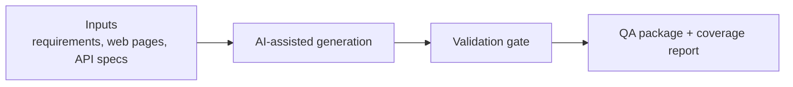

# SmartQA

SmartQA is a TypeScript framework that turns product inputs into a reviewable QA documentation package aligned with ISTQB and IEEE 29119.

## The problem

An LLM can draft test documentation quickly, but the draft is hard to trust: requirements get skipped, scenarios cover only the happy path, and the text sounds confident whether or not it is complete. Speed without verification just moves the work to the reviewer.

SmartQA makes the result verifiable. What the LLM produces is checked before it is accepted, and coverage of requirements is reported, not assumed.

## How it works

**Validation gate:** Every LLM output is checked for completeness and coverage before it enters the package.

## What you get

Requirements, test cases, Gherkin scenarios, checklists, a traceability matrix and a quality report.

## My role

I write the specifications, define the rules the AI agent works under, review its plans and validate the results.

AI-assisted — I direct, specify and validate; the code is AI-generated.

## Status

Private, in active development. Live walkthrough on request (screen-share).

## Learn more

- [Approach](docs/approach.md): the principles behind the results
- [Examples](examples/): output fragments from a demo product

## Contact

TODO(Bogdan): contact details

---

Copyright © 2026 Bogdan Doroshenko. All rights reserved. See [NOTICE.md](NOTICE.md).
